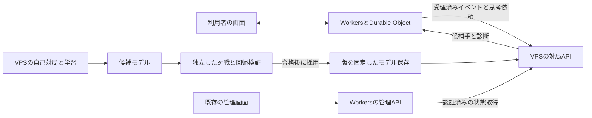

# 四人将棋 Lv3とVPS学習の全体計画

## 今回の実装範囲（2026-10-12の追加指示）

開発者の追加指示により、最初の1日は **自己対局・学習を優先し、実対局用の枠を確保しない**。通常シングルスの三人攻撃禁止ON／OFFを最大5並列・5vCPU・10GiBで交互に回し、監視APIと管理画面を用意する。TetraBoardの対局参加・Lv3選択・思考ジョブAPI・本番配布は後続へ延期する。

今回の実装仕様・起動・停止・exportは [自己対局の運用手順](../ops/shogi-ai/README.md) を参照する。以下は実対局接続まで含む全体計画であり、後続項目の完了を意味しない。初版は共通の8評価重みの最適化、rootの合法交換比較、完了深さの採用を実装する。局面段階別重み・完全な多人数交換探索・日次配布・公開前の棋力測定は後続で扱う。

2026-10-12の開発者の指示に基づき、ConoHa VPSの12GB・6vCPU・SSD100GB・Dockerイメージを使う四人将棋Lv3、自己対局による学習、TetraBoardとの接続を計画する。時間課金での試用期間は、訂正後の指示に従い **1日** とする。初回対象は通常シングルスの三人攻撃禁止ON／OFFの2種類に絞り、管理画面で学習進捗と採用中のLv3の状態を確認できるようにする。

まずLv3の探索と安全評価を改善し、自己対局の結果で評価の重みを更新する。VPSでは学習と利用者向けの思考を別プロセスで実行し、Workersが対局の状態・時計・着手確定を管理する。検証したモデルだけを対局へ採用し、進行中の局では版を固定する。

VPS構成とこの範囲の計画作成は開発者の指示による。本書のAPI、資源配分、時間予算、採用基準は実装へ進むための具体案であり、現在の採用仕様ではない。実装指示時に確定し、README・ルール正本・構成文書も同じ変更で更新する。VPS契約・購入、実装、環境への反映は計画作成に含めない。

## Goal

- 通常シングルスの三人攻撃禁止ON／OFFで現Lv2より強く、ただ取り・取り返せない交換・無意味な王手・高価な合駒を減らした四人将棋専用Lv3を提供する。
- 自己対局、評価の更新、候補の検証、日次成果の保存をVPS上で継続実行できるようにする。
- 既存管理画面から、ON／OFF別の学習段階・完了局数・候補モデル・採用モデル・検証結果・稼働状態を確認できるようにする。
- 学習負荷がある状態でも、TetraBoardのCPU席へ期限内に合法手を返す。
- 1日の試用で起動・再開・性能・通信・資源分離を測定し、継続契約の判断材料を取り出す。試用だけで棋力の採用基準達成を約束しない。
- 将来のAI分析・検討へ流用できる内部診断を残す。分析画面と優勝確率の表示は後続段階とする。

## ContextProviders

| 優先度 | 参照元                                                                                                                                                                                                                           | 用途                                        |
| ------ | -------------------------------------------------------------------------------------------------------------------------------------------------------------------------------------------------------------------------------- | ------------------------------------------- |
| 1      | 今回の開発者の指示、[AGENTS.md](../AGENTS.md)                                                                                                                                                                                    | VPS構成・1日試用・develop向けPR・承認・検証 |
| 2      | [README](../README.md)、[四人将棋ルール](rules/four-shogi.md)                                                                                                                                                                    | CPU席・時計・保存・戦績・ゲームルール       |
| 3      | [CPU実装案内](development.md#四人将棋cpu)、[時計](development.md#workerの時計計算と期限選択)、[構成](architecture.md)、[テスト方針](testing.md)                                                                                  | 実装先と責務                                |
| 4      | `packages/four-shogi/src/`、`apps/worker/src/rooms/fourShogiProgress.ts`、`gameRoom.ts`、`shogiStore.ts`                                                                                                                         | 探索・受理・履歴・Alarm                     |
| 5      | [従来のAI測定](four-shogi-ai.md)、Git履歴、本番棋譜調査                                                                                                                                                                          | 比較対象と失敗局面                          |
| 6      | [Docker資源制限](https://docs.docker.com/engine/containers/resource_constraints/)、[ConoHa Docker](https://doc.conoha.jp/products/vps-v3/image-v3/image-application-v3/docker-v3/)、[ConoHa料金](https://vps.conoha.jp/pricing/) | VPS運用条件                                 |

計画の基点と現Lv2の比較対象は最新develop `5e9031f6313a5aa4432490defc7df46598ddc365`。計画ブランチは `docs/four-shogi-lv3-plan`。実装時はその時点の最新developへ更新し、比較対象のCPUソースを固定して残す。

既存の `bench/cli.ts` が比較する旧Lv2は `3b84f2c` であり、今回の現Lv2とは異なる。段階3で比較コミット・モデルを明示指定できるようにし、旧比較をそのまま今回の採用結果へ流用しない。

2026-10-12の本番調査では、Lv2を含む59局を完全再生し、強化導入翌日以降の33局のLv2全2,983着手を再現した。1,900着手で完了深さ1、2,966着手で予算打切りだった。捕獲された駒すべてを悪手とは扱わず、交換・味方の補償・必要な犠牲を区別して回帰局面を選ぶ。

回帰候補の出典は、[93手目から金を渡す王手を繰り返す対局](https://tetraboard.net/matches/fcbca8d4-34f5-4ce4-8eb2-7d496991c966)、[78手目で王が取り返せない金を進める対局](https://tetraboard.net/matches/c136198c-4cab-45b6-826a-d662acc26928)、[106手目で飛車を合駒にする対局](https://tetraboard.net/matches/a1350340-6338-4f8d-a5db-cdf398cddf55)。fixtureには必要な局面と前後のルール履歴、出典・抽出コミットを残し、参加者名・アカウント情報を保存しない。調査済みのダブルス局面は今回のLv3の問題集合へ含めず、既存Lv1／Lv2の回帰を維持する。

## Constraints

- 初回のLv3・自己対局・学習・VPS接続は通常シングルスの三人攻撃禁止ON/OFFのみへ対応する。Lv3のダブルスは後続段階に延期する。既存Lv1／Lv2のダブルスと、合法手・王手優先・脱落・千日手・引分提案のルールは維持する。
- Lv1・Lv2の選択を維持し、Lv3は四人将棋のシングルスだけへ追加する。他5ゲームと四人将棋ダブルスのLv3はAPIとUIで拒否する。共有のレベル型を広げるだけで全ゲーム・全モードへ許可しない。
- CPU席として保存し、CPU戦を対人戦績・ランキングから除外する既存仕様を維持する。外部BOTを人間アカウントとして参加させない。
- WorkersからVPSへ送る情報は盤面・ルールイベント・匿名化した陣営・内部照合値に限定する。利用者名・アカウントID・認証Cookie・チャット・持ち駒表示専用データは送らない。
- TypeScript/Bunと既存のルールエンジンを共有する。第1版ではGPU・大規模ニューラルネット・Python学習基盤を追加せず、自己対局報酬による評価重みの最適化を実装する。
- 自己対局を本番部屋・D1へ保存しない。本番棋譜の再取得は読取りだけとし、学習用の匿名化コピーを別管理する。
- モデル更新は規則・探索コード・認証設定を変更しない。コード更新は既存のPR・CI・開発環境確認・承認・リリース手順を通す。
- 旧棋譜の読取りを維持する。Lv3参加者を含む新棋譜の公開・本人履歴・再生にも対応し、ルール版は変更しない。モデル版などは内部の付加記録に保存し、ゲーム局面や順位計算へ混ぜない。

## 全体構成



| 担当               | 実装案                                                     | 責務                                                          |
| ------------------ | ---------------------------------------------------------- | ------------------------------------------------------------- |
| ルール・Lv3探索    | `packages/four-shogi/src/` にLv3専用入口・探索・評価を追加 | 合法候補、駒交換、探索、内部診断                              |
| 自己対局・学習     | `packages/four-shogi/bench/` の比較基盤を拡張              | 棋譜、seed、報酬、重み更新、候補比較                          |
| VPSアプリ          | 新しい `apps/shogi-ai/`                                    | Bun HTTP API、思考子プロセス、セッション、モデル検証、運用CLI |
| VPS配置            | 新しい `ops/shogi-ai/`                                     | Dockerfile、Compose、環境例、資源上限、バックアップ・試用手順 |
| 連携               | Workerの専用 `fourShogiRemoteCpu` と既存進行処理           | 履歴同期、ジョブ予約、結果照合、フォールバック                |
| レベル・表示・保存 | protocol・Workerの保存読取り・Web共通CPU選択               | 四人将棋だけのLv3、名前、棋譜と履歴                           |

VPSアプリは `Bun.serve`、組込みSQLite、ファイル保存を使う案とする。HTTPSの入口にはCaddyのDockerイメージを使う案とし、証明書取得用のAIサブドメインを用意する。追加する運用部品はVPS配置に限定する。ホスト名・DNS設定・初期モデル版は実装前の環境設定時に確定する。

管理画面の実装先は `apps/admin/src/` の専用ページ、Workerの管理用プロキシは `apps/worker/src/admin/`、応答の型と検証は `packages/protocol/src/` とする。既存の `adminIdentity`・`ADMIN_ACCOUNT_IDS` を使い、VPS専用の公開管理サイトや新しい監視サービスを追加しない。

## Lv3の探索と評価

### 探索の順序

1. 全合法候補を生成し、即勝利・一手敗北・直後の合法捕獲・取り返しを調べる共通の浅い評価を行う。この比較に専用予算を確保する。
2. 駒損の危険、詰み、王手応手、成り、捕獲を使って候補を並べ替える。静かな逃げ・守り・安い合駒も候補へ残す。
3. シングルス3〜4人生存ではMaxⁿ、2人生存ではαβを土台に探索する。自分の直後の脱落や合法なただ取りは、相手が別の利益を選ぶ予測だけで安全扱いにしない。
4. 戦術延長は王手への応手・捕獲・重要な脅威に絞る。通常の駒打ちまで一律に深く読むことで、浅い比較の完了を妨げないようにする。
5. 予算を使い切ったら、全候補で完了した比較を使う。特定候補だけ深く読んだ値を他候補の浅い値とそのまま比べない。

探索は処理量で再現できるようにし、VPSの壁時計は外側の停止期限に使う。探索子プロセスを外側から停止できる構成とし、BunのHTTP処理を同期探索で塞がない。最初の安全評価・完了した反復ごとに候補を親へ通知し、停止時にも合法な候補を返せるようにする。

開始時の予算候補は16,384・65,536・262,144単位とし、深さ・幅を含む実行設定をモデルとは別のプロファイルへ保存する。単位数や深さは棋力の保証ではなく、VPSの測定で選ぶ。比較先のLv2は既定2,048単位に固定し、Lv3の予算増加による改善と学習による改善を別々に測る。

### 評価特徴と更新対象

- 盤上資産と持ち駒、捕獲による相手の持ち駒増加。
- 捕獲・取り返しの合法性、王の取り返し不能、ピン、途中の王手、第三者の利き。
- 王の安全、合法な退避先、王手応手数、飛車・龍の圧迫。
- 安い合駒と高価な合駒の損失、成りとその後の捕獲、前進と駒の活動。
- 実際の手番が戻るまでの危険、脱落後の陣営数。

第1版のモデルは局面段階ごとの特徴重みを持つ小さなJSONとする。即敗北や合法性などの安全条件は学習で無効化できない。特徴を追加するだけでは学習にならないため、後述の自己対局報酬で重みを実際に更新する。現在の8重みを調整するだけで取り返しの問題を解決したことにしない。

全候補の安全比較そのものが時間内に終わらない局面も測定対象にする。完了した候補と未評価候補を同等の安全性として扱わず、短い予算では確認済みの合法手へ保守的に戻る。安全比較を完了した率と、危険を見逃した率を別に記録する。

## 自己対局と学習

### 第1版の更新方法

三人攻撃禁止ON用とOFF用に親モデル・候補・採用版を分け、共有のエンジンで2系統を学習する。各系統で親から許可範囲内の重みを少し変えた候補を2個作る。共通の開始局面・seed・席の入替えで親と候補を対戦させ、良い候補を次の親へ採用する進化的なパラメーター最適化を使う。初期は1候補の比較につき対象設定8系列×4席を使い、差が小さいときは追加対戦する。これは調整用の小さな比較であり、本番採用判定ではない。

系統IDは `singles-restricted` と `singles-unrestricted` とする。ON／OFFへ計算時間を交互に配り、初回は両系統と検証を合わせて最大5探索プロセスとする。実対局用の枠を確保する後続段階では学習を最大3プロセスへ減らす。各系統へ上限分を重複して割り当てない。片方だけが採用基準を満たした場合は、もう片方の採用版を維持する。

モデルファイル、探索予算、コードのコミット、seed、開始局面のハッシュ、全結果、比較した親を記録する。収束して変化が止まった場合は摂動幅を調整し、改善がない日は親を維持する。毎日必ず更新するという条件にしない。

| 対象           | 更新に使う報酬案                                                                |
| -------------- | ------------------------------------------------------------------------------- |
| シングルス     | 順位を1位1・2位2/3・3位1/3・4位0へ写像した得点を基本に、単独1位率と駒損も別集計 |
| 学習中の長期戦 | 測定上限800手で未終局として保存。未終局をルール上の引分や勝利へ変更しない       |

シングルスの千日手・合意による同率1位はエンジン結果として保持し、単独優勝と別に記録する。引分だけを増やす候補を避けるため、順位得点だけで採用せず、単独優勝・引分・未終局率も比較する。長期戦上限は測定器だけの制約で、サービスのルールへ追加しない。

### 相手とデータの分離

- 相手は固定Lv2、固定Lv3初期版、直近の採用版、過去モデル・重みの異なるモデルを組み合わせる。新候補が常に全4席を独占する自己対局だけにしない。
- シングルスのON／OFFと4席を均等に回す。初期局面だけでなく、合法に進めた序盤と匿名化したシングルスの実戦局面を含める。
- 調整用、日次検証用、公開前の未使用最終評価用を対局単位で分ける。同じ棋譜の途中局面と回転局面を別集合へ跨がせない。
- 本番調査で既に見た失敗局面は回帰・調整へ使い、未知の棋力の証拠にしない。日次検証を繰り返し使った集合も、最終評価用へ昇格させない。
- 棋譜はJSONLなどで追記し、集計とモデルは原子的に保存する。中断後は完了済み局を二重計上せず再開する。

第2段階では、十分に探索した局面の評価と最終順位を学習データにし、小さなニューラル評価器を検討する。4陣営の値、三人攻撃履歴と反復履歴を表現する必要がある。依存技術・教師信号・計算費用を別途比較してから採用し、今回の初期試用では必須にしない。ダブルスへ拡張する際はチーム評価・味方の補償・採用基準を別途追加する。

## VPSの運用

初回は学習用5vCPU・10GiB、HTTPS入口0.25vCPU・256MiBを上限とし、残りをOS・保存・監視へ残す。以下の表と実対局ジョブの運用は、実対局を併用する後続段階の構成案である。

| 用途                           | メモリ上限の初期案 |   CPU上限の初期案 | 並列数            |
| ------------------------------ | -----------------: | ----------------: | ----------------- |
| 学習・自己対局・候補検証の合計 |                6GB |         3vCPU相当 | 最大3探索プロセス |
| 対局APIと思考の合計            |                3GB |         2vCPU相当 | 最大2探索ジョブ   |
| HTTPS入口                      |              256MB |       0.1vCPU相当 | 1プロセス         |
| OS・Docker・運用の余裕         |        残り約2.7GB | 残り約0.9vCPU相当 | —                 |

メモリはホストの実容量とバイト単位で合わせ、GBとGiBを混同して合計が実容量を超えないようにする。DockerのメモリとCPUのハード上限を設定し、学習・検証が対局用の枠へ入り込まないようにする。CPU上限は専用物理コアや応答時間の保証ではない。試用では学習停止時と最大負荷時の両方を測る。

対局ジョブは締切の早い順に処理し、待ち行列の初期上限は8件。受付時点で間に合わないジョブは過負荷として返し、Workersの代替処理へ渡す。利用者との同時対局数を2部屋へ制限するという意味ではなく、実際に同時思考できる数が2である。1人対CPU3体の部屋を複数動かして容量を測る。

CPU待ち・メモリ・swap・ディスク・遅延・フォールバック率・学習世代・局数を記録する。学習データの初期枠40GB、ログ2GB、モデルと付加記録5GBとし、残りをOS・イメージ・余裕へ残す。ディスク空き20GB未満では学習を止め、現採用版と必要な測定結果を消さずに整理する。ログはローテーションし、モデル・結果をVPS外へ保存する。

コンテナは再起動可能にし、モデルは読み取り専用で対局側へ渡す。学習側は候補置き場へ書き、検証を経た版だけを別の採用操作で有効にする。API鍵はSecretsとVPS環境へ置き、Git・モデル・ログへ含めない。開発と本番は認証・セッション・採用版の名前空間を分ける。

## TetraBoardとの接続

この節の実対局接続は後続へ延期する。今回の接続は既存管理者認証を使う読取専用の進捗監視に限定する。

### ルール状態と履歴の同期

VPSは共有エンジンで受理済みイベントを再生し、ゲーム局面、三人攻撃、取り返し免除、千日手履歴を復元する。現在の公開盤面だけを送って履歴を空にしない。

セッションとジョブには系統IDを含め、シングルスと三人攻撃禁止設定から計算した系統が一致する場合だけ受理する。ON用モデルをOFFへ使う要求、ダブルス、未知の系統は設定不一致として拒否する。

対局ごとに内部セッションを作り、開始情報とイベントを連番で同期する。通常は追加分だけを送る。WorkerとVPSでイベント位置、イベント列のハッシュ連鎖、現在局面のダイジェストを照合する。参加者のIDはセッション内の4陣営の固定仮名へ写像し、イベントに利用者情報を入れない。公開の対局IDとVPSセッションIDの対応はWorker内部で保持する。

VPS側は受理済みイベントとチェックポイントを組込みSQLiteへ保存する。同じイベントの再送は同一内容のときだけ受理し、欠落・順序違い・内容違いを拒否する。VPSがセッションを失った場合は初期情報から再同期し、その着手では期限内に復旧できなければ代替CPUを使う。

初期・復旧同期は1回のAlarmあたり最大400イベント、1リクエスト最大100イベントを出発点にする。長期局の全履歴を毎手走査せず、SQLiteの範囲読取りを使う。全同期が完了しない局面で履歴不足のVPS手を採用しない。脱落・引分提案・取消も同期対象とする。

### 非同期ジョブとAPI

| API案                          | 内容                                                                                           |
| ------------------------------ | ---------------------------------------------------------------------------------------------- |
| `GET /healthz`                 | 起動確認だけ。鍵や利用者情報を返さない                                                         |
| `PUT /v1/sessions/:id`         | 初期設定・ルール版・エンジン版・モデル版の登録                                                 |
| `POST /v1/sessions/:id/events` | 受理済みイベントの差分・位置・ハッシュを同期                                                   |
| `POST /v1/jobs`                | ジョブID、セッション、局面ダイジェスト、イベント位置、手番、モデル版、処理量・時間・期限を指定 |
| `GET /v1/jobs/:id`             | queued・running・completed・failed・expired、候補手・完了深さ・処理量・モデル版                |
| `DELETE /v1/jobs/:id`          | 古い局面の計算を中止。処理済みでも冪等に扱う                                                   |

HTTPSと共有鍵による認証・署名、要求の時刻と再送照合を設ける。ジョブIDの同一要求は同じ結果へ結び付け、別局面・別モデルでのID再利用は拒否する。署名を含む秘密情報はログへ残さない。

WorkerはAlarmで局面を読み、内部KVへジョブを予約してから外部通信する。通信をDOの同期transactionや長時間の `blockConcurrencyWhile` 内で行わない。外部通信の後は最新の部屋を再読取りし、期限・局・部屋世代・revision・CPU本人／レベル・手番・モデル版を再確認して結果を保存する。次Alarmで通常エンジンを使って一度だけ着手を確定する。

進行中のジョブはKVに永続化し、DO休止・再起動・Alarm再送で計算を重複予約しない。部屋閉鎖・脱落・再戦・引分成立・手番変更・設定変更で古い結果を採用しない。チャット・スタンプ・通常GETから思考を起動しない。入力を拒否した場合も棋譜や反復辞書を更新しない。

### 思考時間と失敗時の扱い

初期のVPS思考目標は最大3秒、ポーリング間隔500ms、単一HTTP通信の上限1秒、キュー・通信を含むリモート待ち上限5秒とする。いずれも局の時計から決める期限を上回らない。

毎手の使える時間から、代替選択の実測p99時間と確定処理の余裕を先に引き、残りを同期・キュー・思考へ配る。代替選択の余裕は初期500msを仮置きし、Workerで測って増減する。時間が足りない手番はリモートを開始せず、代替を選ぶ。期限そのものを延ばさず、時間切れは着手より優先する。

CPUの最低2秒待機は維持する。既存実装は2秒経過後に思考を起動するため、最初の接続もその順序を維持し、待機・ネットワーク・計算・確定をすべて持ち時間へ含める。将来の早期思考開始は別の改善として測定する。

利用者が見る着手までの時間は、最低待機2秒にリモート処理が加わる。通常の目標は合計約3〜6秒、リモート待ち上限まで進む場合は約7秒に確定処理が加わるため、この体感も開発環境で確認する。時間が短い設定ではこの目標より期限を優先する。

通信失敗・不正応答・版違い・VPS停止・過負荷・期限超過時は、Workers上の処理量を制限したLv3の代替探索へ切り替える。代替探索は改善した安全評価を共有し、VPSの学習環境へ依存しない。入力照合後に合法性を再検査し、既定のLv2を予備の比較対象として維持する。代替経路で思考期限を超えれば通常の時間切れとし、時計を止めない。

Lv3の表示レベルは失敗時も維持し、実際のエンジン・モデル・代替使用を内部の付加記録へ残す。棋力測定と運用レポートではVPS経路と代替経路の率を分離する。

### UIと保存の変更範囲

`cpuLevelSchema` は現在共有の1／2なので、レベル3の型だけでなくゲームごとの対応レベルを定義する。四人将棋シングルスの作成・待機室・CPU変更・再戦だけへLv3を表示し、サーバーでもゲームとモードを検証する。Lv3を含んだままダブルスへ変更する要求は拒否し、Lv1／Lv2へ変更する案内を表示する。既定レベルとLv1／Lv2の選択は維持する。

四人将棋の参加者保存型、保存済み対局の検証、公開・本人履歴、CPU名の表示をLv3へ対応させる。モデル版・思考時間・代替使用・探索診断は別の内部記録とし、過去棋譜のJSONを一括変更しない。新しい付加保存にD1 migrationが必要になった場合は、実装PRでDDLと影響をレビューし、必要になるまで本番migrationを実行しない。

## モデルの採用と日次運用

モデルには `modelVersion`、`profileId`、`engineCommit`、`featureVersion`、対応設定、重み、探索プロファイルの版、SHA-256、生成条件を持たせる。負値を許す特徴と許さない特徴を区別し、未知キー・非有限値・範囲外・版違いを読込み時に拒否する。

毎日JST 09:00を締切の初期案とし、最良候補・棋譜・学習進捗・検証結果を保存する。学習チェックポイントは15分ごとと世代終了時に保存する。検証が終わらない日も成果を保存し、未検証候補を採用しない。

試用と初回公開では開発者が結果を確認して採用操作を行う。継続運用の自動採用は、採用条件と公開運用に対する承認後に有効化する。規則変更・コード変更をモデル更新として自動公開しない。

採用版は不変のファイルとして登録し、新しい局の開始時に三人攻撃禁止設定から選んだ系統と、その採用モデル版をDO内部へ固定する。旧局が終わるまで旧版を保持する。並行読込み中にファイルを上書きせず、検証済みの参照を原子的に切り替える。問題時は新しい局の参照を前版へ戻す。旧局で同じ版を利用できない場合は、別モデルへ黙って切り替えず代替CPUで継続する。

## 管理画面での進捗とLv3の確認

既存管理画面に `/admin/four-shogi-ai` を追加し、「三人攻撃禁止ON」「三人攻撃禁止OFF」で表示を切り替える。共通のVPS稼働状況と、系統別の学習・検証・採用を表示する。初期版は状態の閲覧・自動更新・手動更新を提供し、モデル採用・停止・再起動の操作ボタンは後続の運用機能とする。

| 表示するまとまり | 項目                                                                                                             |
| ---------------- | ---------------------------------------------------------------------------------------------------------------- |
| 現在の段階       | 初期化、自己対局、評価更新、候補検証、採用待ち、停止、失敗。開始・最終進捗時刻、保存からの再開の有無             |
| 学習の進み具合   | 実行ID、世代番号、累計完了局数、現在の比較の完了局数／予定局数、進行中局の手数、局数／時間、次のチェックポイント |
| 採用しているLv3  | 系統、モデル版、エンジンコミット、採用日時、元の親版、検証合格／未検証。開発環境と本番の採用先を分ける           |
| 学習中の候補     | 親版、候補版、生成日時、検証中／合格／不合格／未完了。採用版との違いを短く表示                                   |
| 強さの測定結果   | 固定Lv2と親モデルそれぞれに対する単独1位率・平均順位・引分率・未終局率、局数、95%区間、探索予算、測定日          |
| 対局サービス     | 稼働・heartbeat、実行中／待ち行列、直近の完了・失敗件数、思考p50／p95／p99と測定件数                             |
| 資源と障害       | 学習・対局プロセスのCPU使用量・メモリ使用量／上限、データ領域の空き容量、直近の失敗理由、最終成功時刻            |

学習は継続するため、全体を「完成度70%」のような割合へ変換しない。現在の比較だけは予定局数を分母に進捗を表示できる。勝率は相手・設定・予算・件数を必ず付け、学習対局の成績と未使用集合の検証結果を混同しない。計測していない項目は `null` として「未測定」、収集に失敗したものは「取得失敗」と表示し、0へ置き換えない。

### 状態取得APIと集計

| 経路案                                                               | 返す内容                                                      |
| -------------------------------------------------------------------- | ------------------------------------------------------------- |
| VPS `GET /v1/admin/status`                                           | 共通稼働状態とON／OFFの学習・候補・採用スナップショット       |
| VPS `GET /v1/admin/runs?profileId=...&cursor=...`                    | 指定系統の学習・検証結果の要約を20件ずつ取得                  |
| Workers `GET /api/admin/four-shogi-ai/status`                        | 既存管理者認証後にVPSの状態を取得・検証し、画面用の応答を返す |
| Workers `GET /api/admin/four-shogi-ai/runs?profileId=...&cursor=...` | 同じ認証と許可したクエリだけで結果の追加取得を代理する        |

VPS側は状態を5秒ごとと段階変更・対局終了・チェックポイント時に更新し、SQLiteへ小さなスナップショットと要約を保存する。HTTP応答で全棋譜を走査したり、対戦測定・学習を開始したりしない。集計は単純なBun処理と既存の管理画面のグラフ部品を使う。学習の状態を報告する親プロセスと、対局のHTTP親プロセスは探索子プロセスから分け、同期探索で状態取得が止まる構成を避ける。

応答には `schemaVersion`、`generatedAt`、各プロセスの `heartbeatAt`、`runId`、`profileId`、モデル版・コミット・計測窓・件数を含める。過去のモデルの勝率を現モデルの成績として表示しない。工程の完了は実際のイベントと検証結果に基づけ、管理画面がソースコードの開発進捗を自動推測する仕組みにしない。

VPSだけではWorkersでの代替CPU使用回数を観測できない。代替率はWorker内部の付加記録から測った値だけを使い、集計が未実装の段階は「未測定」とする。VPSの失敗件数から代替率を推測しない。

### 認証と更新時の表示

ブラウザは同じTetraBoardオリジンの管理APIだけへアクセスする。WorkersがVPSの固定HTTPSホストへアクセスし、VPS用の鍵を付ける。ブラウザへVPS鍵を渡さず、任意URLをプロキシできるAPIにしない。状態取得には読取り専用の権限・鍵を使い、思考ジョブやモデル更新の権限を与えない。応答から鍵・内部ファイルパス・利用者情報・機密ログを除く。

管理者判定は毎リクエストで行い、未認証401・権限なし403・管理者設定不備503を既存仕様に合わせる。VPS未設定・通信失敗は接続不可として返し、空の成功応答にしない。上流応答の型・容量・系統を検査し、HTTP timeoutは2秒、応答容量上限は256KiBを初期案とする。認証前にVPSへ通信せず、管理HTTP応答は `Cache-Control: no-store` とする。

画面は表示中だけ10秒ごとに取得し、タブが非表示なら止める。前回の要求が終わる前に次の要求を出さない。自動更新は既存表示を保ち、手動更新だけ処理中表示を出す。更新失敗時は最後の取得結果とその時刻を残して「更新失敗」を表示する。heartbeatが30秒以上古い場合は「状態更新が途絶えています」と表示し、通信可能なAPIを根拠に学習も正常と判断しない。401／403では表示済みの管理データを破棄する。

状態取得は初期化時以外に軽いスナップショット読取りで済むようにし、VPSでの応答p95が200ms以内を目標にする。最大学習負荷下で管理画面を更新しても、対局の性能基準が崩れないことを1日試用で確認する。

## 実装順序と成果物

契約時間を実装待ちで消費しないため、段階1〜5をローカルで準備してからVPSの1日試用を開始する。試用後に採用基準を満たしてから公開する。

| 段階 | 作業                           | 成果物と確認                                                                                            |
| ---- | ------------------------------ | ------------------------------------------------------------------------------------------------------- |
| 1    | 仕様案と本番失敗局面を整理     | ルール正本・READMEのLv3仕様、匿名化fixture、独立した正解条件、調整／評価の分割                          |
| 2    | Lv3探索とローカル代替を作る    | 専用探索・評価、安全比較、予算中断・決定性・取り返し・手番のテスト                                      |
| 3    | 自己対局と重み更新を作る       | 親と候補の対戦、更新する学習器、モデルmanifest、再開・重複排除、比較レポート                            |
| 4    | VPSアプリと配置を作る          | HTTP API、探索子プロセス、履歴同期、SQLite、Docker・HTTPS、資源制限、export CLI                         |
| 5    | WorkerとUI・管理画面を接続する | 永続ジョブ・時間予算・代替・版固定、シングルス限定Lv3、履歴と保存、進捗APIと管理画面、偽VPSの統合テスト |
| 6    | 12GB VPSで1日試用する          | 性能、学習世代、候補対戦、同時対局、開発環境からの通信、成果の持出し                                    |
| 7    | 長期測定と採用判断             | 未使用集合での最終測定、必須検証とCI、開発環境の手動対局、公開承認、リリース                            |

コミットは変更種別と日本語説明を使う。例は `feat: 四人将棋Lv3の合法な取り返し評価を追加する`、`feat: VPSで自己対局による評価更新を実行する`、`feat: 四人将棋Lv3を外部思考ジョブへ接続する`。実装は最新developから `feat/four-shogi-lv3` を基点にし、機能単位でdevelop向けPRへ分割する。ローカルLv3を先に検証できる状態にして、VPS接続の失敗と棋力の問題を分ける。

## 1日の試用手順

試用開始はConoHaでサーバーを作成した時刻T0とする。開発者が契約・IPとSSH接続の準備を行い、事前に準備した固定版のイメージ・モデルを配置する。SSH秘密鍵やAPI鍵はチャット本文へ貼らず、利用可能な秘密情報の設定経路で扱う。

| T0からの経過 | 実行する内容                                                                                                                                                        | 残す結果                                                         |
| ------------ | ------------------------------------------------------------------------------------------------------------------------------------------------------------------- | ---------------------------------------------------------------- |
| 0〜2時間     | SSH・Docker・TLS・保存先・資源上限を確認。APIと学習器を起動し、10局程度の動作確認と開発Workerから1手の往復                                                          | 構成・コミット・起動／再起動・通信・復元結果                     |
| 2〜5時間     | 固定100局面で3種類の探索予算を測定。学習停止時と最大負荷時に同じ測定を実行                                                                                          | p50／p95／p99、完了深さ、処理量、メモリ、キュー、代替率          |
| 5〜16時間    | シングルスのON／OFFを巡回し、親・候補・相手の版を記録して自己対局と重み更新を継続。管理画面で両系統の更新を確認                                                     | 完了局数、世代数、更新前後の重み、未終局・失敗、チェックポイント |
| 16〜20時間   | 系統別の最良候補を凍結し、日次検証用の共通系列で親と比較。件数は実測速度に合わせ、最低ON／OFF各10系列×4席を目指す                                                   | 比較結果と不確実性、必要な最終測定時間の見積もり                 |
| 20〜22時間   | 開発環境で人間1人＋Lv3を含むCPU3体のシングルスをON／OFFで対局。通信断・API再起動・過負荷・再戦と管理画面の更新失敗表示を確認し、想定ピークを模した100思考依頼も実行 | 手番・時計・着手・保存、失敗時代替、実通信の遅延、管理画面の表示 |
| 22〜24時間   | 新規学習を止め、終了可能なジョブと成果を保存。VPS外へexportし、チェックサムとローカル読込みを確認。継続／終了を判断                                                 | モデル、棋譜、進捗、比較・性能レポート、再開手順                 |

0〜2時間で起動・認証・通信が成立しなければ、先に障害を解決し、残り時間へ学習を詰め込んで成功扱いにしない。学習で採用に値する改善がない場合も、測定結果・前版・候補を持ち出す。

試用終了時に終了を選ぶ場合、exportの読込み確認後に開発者がConoHaで削除する。時間課金は単なる電源停止を終了手段にせず、[公式の削除手順](https://support.conoha.jp/v/deletevps/)に従う。VPS削除はデータを失う操作なので自動実行しない。

12GBの公式時間単価は確認時点で13.2円。24時間分の目安は約317円で、追加オプションと請求上の丸めは別とする。申込み時の表示を優先する。[公式料金](https://vps.conoha.jp/pricing/)

## Done When

### Lv3の初回公開に使う基準案

| 対象         | 採用条件案                                                                                                                                                                     |
| ------------ | ------------------------------------------------------------------------------------------------------------------------------------------------------------------------------ |
| 合法性・互換 | 入力不変、通常APIとの遷移一致、既存固定棋譜とLv3の新棋譜再生、他5ゲームと四人将棋ダブルスでLv3拒否が成功                                                                       |
| 戦術         | 既存104ケースに加え、独立した原局面を30以上追加。重要な強制回避問題は全問、追加全体は90%以上。犠牲が必要な問題で「捕獲される手を全拒否」する実装を落とす                       |
| シングルス   | 固定の現Lv2三体にLv3一体、ON／OFF各100系列×4席の400局。単独1位率40%以上、開始系列単位bootstrapの95%下限が25%超、平均順位2.2以下                                                |
| 学習効果     | 同じLv3コード・探索予算で更新前と更新後を未使用系列で比較。未学習版と同等なら学習が強くしたとは報告しない                                                                      |
| 日次候補     | 独立の日次系列で親より順位得点が改善し、95%区間の下限が0超。重要戦術の失敗なし、引分・未終局の増加が各5ポイント以内。件数不足・不明確なら親を保持                              |
| VPS性能      | 最大学習負荷・想定同時思考2件で、上限3秒の探索結果を含むAPI往復p95が4秒以内、p99が5秒以内。時計不足の意図的代替と通常の通信失敗を分け、通常条件の代替率1%以下を目標にする      |
| 時計・運用   | 最低2秒、期限優先、古い／重複応答、同期不一致、DO・VPS再起動、代替、モデル固定とロールバックを検証                                                                             |
| 管理画面     | ON／OFF・候補／採用版を分離して表示。認証、未測定、件数、時刻、更新失敗・古い状態を確認。最大学習負荷下で状態APIのp95が200ms以内、管理画面の更新による対局性能の基準違反がない |
| 保存・報告   | 対象コミット・モデル版・予算・全対戦結果・seed・環境・未確認事項を保存。初回公開前に必須5コマンドとGitHub CIが成功し、開発者が承認                                             |

各対戦は同じ固定の開始系列・席の入替えで比較し、同系列や回転を独立サンプルとして数えない。未終局は0得点で分母に残し、合意・反復引分を分ける。VPSの探索時間はオンラインのプロファイルに合わせる。調整のために採用基準を黙って変更しない。

この棋力目標は今回の「かなり強いLv3」に向けた案であり、実測結果ではない。1日の少数対戦を初回公開の最終測定の代わりにしない。試用では起動・通信・継続学習・再開・資源分離・成果持出しが確認でき、必要な継続時間を見積もれれば判断材料が揃う。

### 検証方法

純粋関数のBunテストで探索・交換・モデル読込み・報酬・更新・seed・集計を確認する。VPSアプリのBunテストでHTTP契約・認証・ジョブ期限・子プロセス停止・イベント再送・SQLite復旧と状態スナップショットを確認する。Bun＋happy-domでシングルス限定Lv3のUIと棋譜表示、管理画面のON／OFF切替・候補と採用版・偽時計での更新・visibility・古い状態・障害・401／403時の破棄を確認する。Worker統合テストで偽VPSを使い、実ネットワーク待ちなしで非同期予約と再照合を確認する。管理APIの認証前の通信拒否、読取り専用権限、型と容量の検査、鍵の非公開、no-store、timeoutも確認する。

1日の試用では実ConoHaと開発Workerで、TLS・ネットワーク・資源制限・実時計・同時負荷を測る。自動ブラウザテストは追加しない。CPU負荷時の本番速度や人間相手の強さをローカル結果から推測しない。

実装PR前は各変更対象に対して次をすべて成功させ、コード・設定更新後は再実行する。

```sh
bun run check
bun run build
bun run --cwd apps/worker deploy:dry-run
bun run build:development
bun run --cwd apps/worker deploy:dry-run:development
```

文書だけのPRは同一コード・設定に対する成功結果を再利用できるが、検証済みコミットを確認して明記する。文書整形と `git diff --check` は最終差分で行う。新規VPSアプリをworkspaceへ追加するときは、その型・lint・必要なテストも `check` に含める。長時間の学習・対戦測定は通常の `check` へ含めない。

## 公開と将来の分析機能

Lv3選択はまず開発環境で有効化し、本番は環境フラグで無効のまま確認する。必要なSecrets・APIホスト・モデル・付加記録を準備し、develop上の確認後、CI成功と開発者の承認を得てdevelop→mainリリースPRをマージコミットで取り込む。対局途中の版固定、前版への戻し方、VPS停止時の代替率を公開手順に含める。

将来の検討用には候補手、陣営ごとの評価、読み筋、探索量・完了深さ・モデル版を内部で返せるようにする。点数は陣営間の比較値として扱い、未較正の値を「優勝確率」と表示しない。検討を長時間動かすときは対局用の枠を優先し、学習用の枠で処理するか別VPSを検討する。

分析・検討の画面、保存期間・公開範囲、モデルに依存する評価表示、優勝確率の較正、ニューラルモデルの依存技術、Lv3のダブルス対応はこの初回実装後の仕様として決める。
